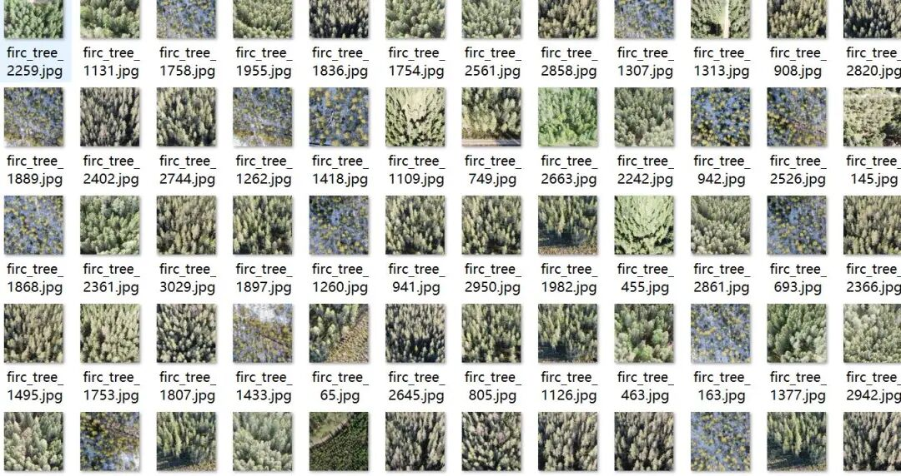
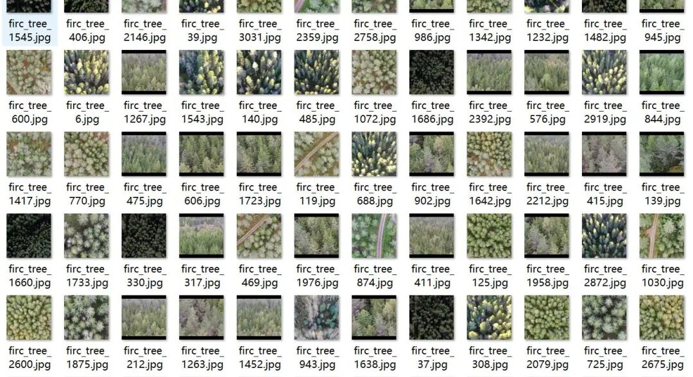
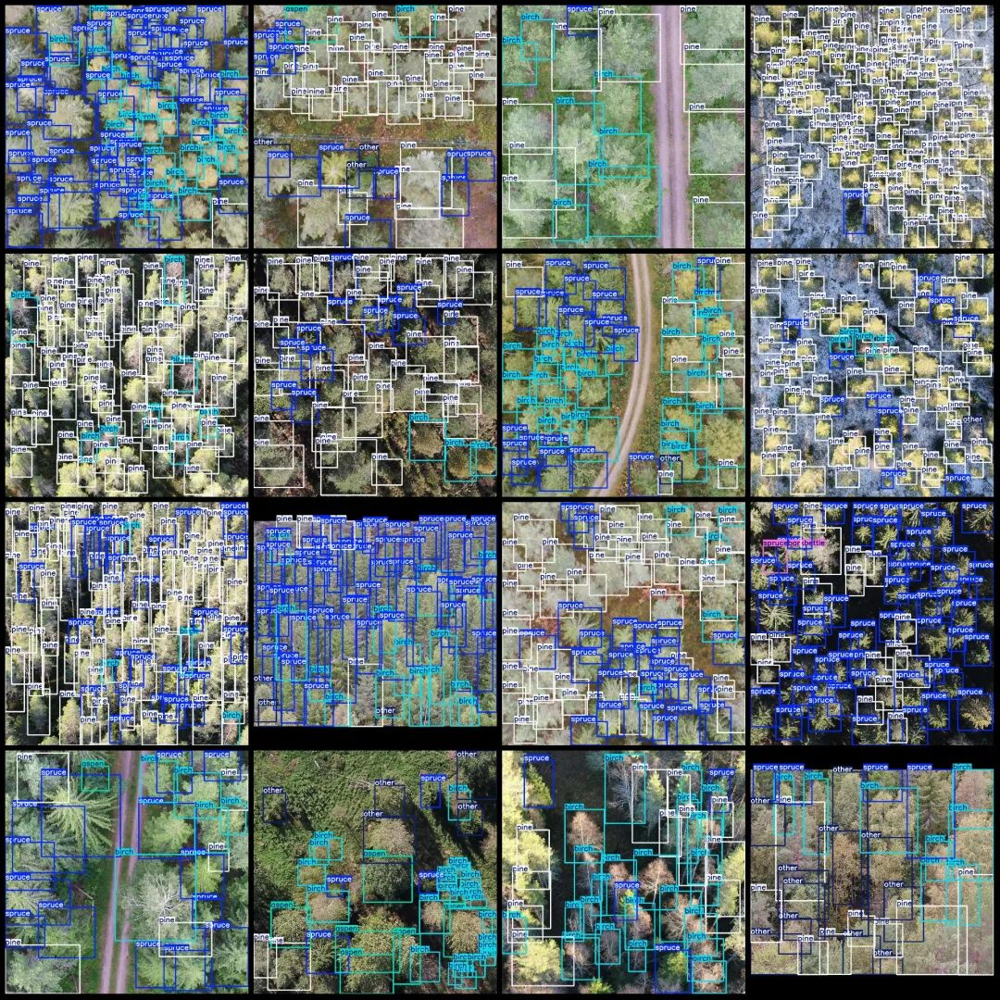
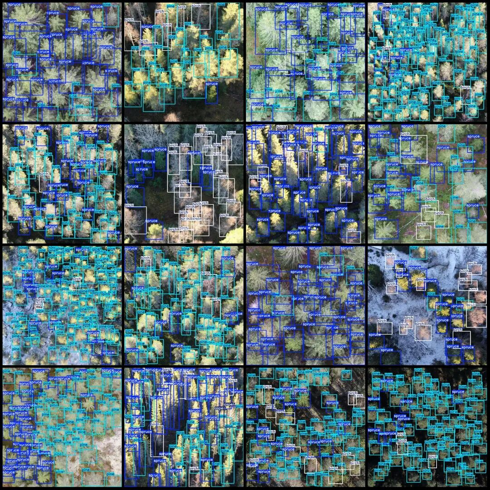

# UAV Perspective Five Types of Trees Identification and Inspection: Pine, Spruce, Birch, Detection Dataset in VOC+YOLO format with 3071 images across 6 categories

Dataset format: Pascal VOC format + YOLO format (txt file without split path, only containing jpg images and corresponding VOC format xml files and yolo format txt files)

Number of images (number of jpg files): 3071

Number of annotations (number of xml files): 3071

Number of annotations (number of txt files): 3071

Label count: 6

Label category names (note that the order of yolo format categories does not correspond to this, but is based on the labels folder's classes.txt): ["aspen", "birch", "other", "pine", "spruce", "sprucebark bettle"]

Number of boxes labeled in each category:

Aspen (Populus tremuloides) Frame Count = 796

Birch (Birch) Frame Count = 28178

Other (other) Frames = 2971

Pine (pine tree) frame count = 79845

Spruce (fir) Frame Count = 78743

Sprucebark beetle (Cloud pine bark beetle) frame count = 147

Total frames: 190680

Image resolution: 1024x1024

Using labelImg:

Annotation rules: Draw a rectangle around the category.

Important Notice: No

Special : This dataset does not guarantee the accuracy of the trained models or weight files.

Drone: DJI MAVIC 2

Collection height: 20~60m

Sampling angle: 70-90°

Image Preview:

Annotation example:

## Payment

Here is a pay link on Stripe ( https://buy.stripe.com/3cs8yP7sY87d0vu9AB ). Please contact me lonlonago@foxmail.com after funding $89, and I will send you a complete data files , thank you!

